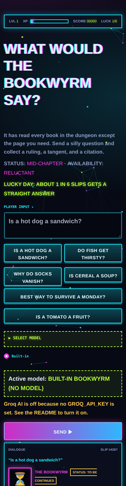

# What Would the Bookwyrm Say?

**Live app:** https://bookwyrm-app.streamlit.app/

| Desktop | Mobile |
|---|---|
|  |  |

A gaming-style Streamlit app. Ask a silly question and a fictional book-hoarding dragon answers with a tangent,
invented footnotes and a mood emoji. About one question in six is a lucky day, with a straight, correct answer and confetti.

Replies come from a Groq-hosted model (default llama-3.3-70b-versatile) when a key is configured, and from a built-in reply bank otherwise.

## Where this idea came from

Every friend group has one. The friend who has read every book ever printed, and who answers "Is a hot dog a
sandwich?" with a tangent, a footnote and a very serious sip of coffee. Ask for advice and you get a shrug and
a joke. Ask for a straight answer and they suddenly have somewhere to be.

But about once in a blue moon, that same friend says one genuinely thoughtful thing so good that you forget you
were annoyed. You can't stay mad at a friend like that, so I did the sensible thing and turned them into a
dragon.

That's the Bookwyrm. It is completely fictional, hoards books like treasure, cites sources that don't exist,
and dodges questions with great confidence. Once in a while (about 1 in 6) it has a **Lucky Day** and
finally gives a proper answer, with confetti, because rare wisdom deserves a parade.

It started as a dare and a silly weekend project, and now it's yours to share with your own annoying friends.

## Run it on your laptop

    pip install -r requirements.txt
    cp .streamlit/secrets.toml.example .streamlit/secrets.toml   # then put your Groq key inside
    streamlit run app.py

No key? It still works with the Built-in model.

Cheers!
