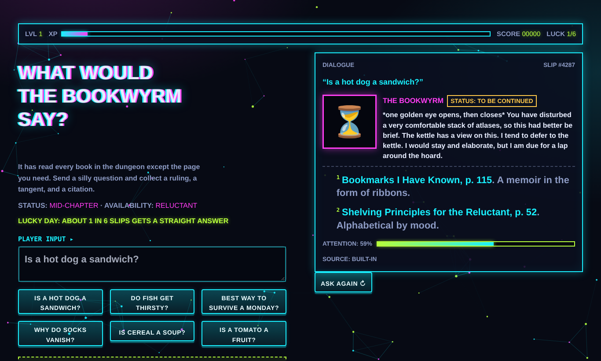

# What Would the Bookwyrm Say?

**Live app:** https://bookwyrm-app.streamlit.app/

| Desktop | Mobile |
|---|---|
|  |  |

A gaming-style Streamlit app. Ask a silly question and a fictional book-hoarding dragon answers with a tangent,
invented footnotes and a mood emoji. About one question in six is a lucky day, with a straight, correct answer and confetti.

Replies come from a Groq-hosted model (default llama-3.3-70b-versatile) when a key is configured, and from a built-in reply bank otherwise.

## Run it on your laptop

    pip install -r requirements.txt
    cp .streamlit/secrets.toml.example .streamlit/secrets.toml   # then put your Groq key inside
    streamlit run app.py

No key? It still works with the Built-in model.

## Share it with friends (Streamlit Community Cloud, free)

1. Create a GitHub repo and push these files. `.gitignore` already keeps `secrets.toml` out.
2. Go to share.streamlit.io, sign in with GitHub, choose **New app**, pick the repo, and set the main file to `app.py`.
3. Open **Advanced settings > Secrets** and paste:

       GROQ_API_KEY = "your-new-key"

4. Deploy, then send the app URL to Harsh and your friends.

## Things to know

- **The key stays on the server.** Visitors never see it. Rotate it at console.groq.com/keys if it ever leaks.
- **Everyone shares your free Groq quota.** The app allows 20 AI calls per minute across all visitors and 40 per visitor,
  then quietly uses the built-in replies and says why. Change `MAX_CALLS_PER_MIN` and `MAX_ASKS_PER_SESSION` in `app.py`.
- **Privacy.** Questions are sent to Groq when Groq AI is selected. The app itself stores nothing; history lives only in the visitor's session.
- **Every reply shows its source** (Groq AI or built-in, plus the reason for any fallback), so you can always tell which one answered.
- To limit who can open it, use the app's Share settings on Community Cloud to invite specific people.
